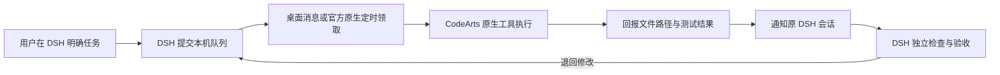

# DSH × CodeArts Desktop Task Queue

[English](README.en.md) · [安装与本地接入](docs/installation.md) · [使用与工具参数](docs/usage.md) · [原生定时自动领取](docs/automation.md) · [故障排查](docs/troubleshooting.md) · [验证范围](docs/verification.md)

把 DeepSeek Harness 的具体开发任务交给本机 CodeArts 桌面端。通过桌面消息或用户配置的官方原生定时任务领取，CodeArts 完成交付后，由发起任务的 DSH 会话独立检查文件、运行必要测试并记录验收结果。

**当前版本为 `v0.1.0-alpha.6` 社区实验版。** Windows 本机真实桌面闭环已通过，覆盖派发、手动领取、官方定时领取、文件交付、自动通知、DSH 独立验收、退回修订、取消及空队列。受阻通知及冷会话恢复另经原生宿主隔离验证。适用版本和实测范围见验证记录。[真实桌面验收](docs/desktop-verification-20261111.md) [原生定时领取与验收](docs/automation.md)

升级到 alpha.5 时先安装固定依赖，再运行配置脚本。该版本修复了旧安装器把 YAML 中 off 等字符串转换为布尔值的问题。已有配置应对照安装备份核对相应字段。[升级与恢复](docs/installation.md#升级) [相关排查](docs/troubleshooting.md#安装后其他插件出现-off-或-false-校验错误)



## 适合怎样的工作

- DSH 负责拆解需求，把范围明确的实现任务交给 CodeArts 桌面。
- 开发者希望看见桌面执行过程，并保留原生文件、终端及权限确认。
- 任务完成后，希望主 DSH 会话读取真实文件、核对测试并决定是否接受交付。
- 领取频率由用户掌握，空闲时通过本机数据库监测交付状态。

## 工作方式

| 组件 | 职责 |
| --- | --- |
| `codearts_queue.py --role dispatcher` | 向 DSH 提供提交、查询、验收、取消四个 MCP 工具 |
| `codearts_queue.py --role executor` | 向 CodeArts 官方连接器提供领取、进度、交付三个工具 |
| `relay/index.js` | 绑定任务与发起 DSH 会话，在交付后发送检查通知 |
| SQLite 队列 | 保存项目路径、任务要求、领取归属、进度和验收证据 |
| `scripts/configure.py` | 生成配置、备份接入、静态检查及卸载 |

登录、账号凭据、模型调用和计费由对应官方客户端处理。队列程序通过本地 stdio MCP 与客户端通信，交付以项目文件路径和回报记录表达。

## 准备条件

- 同一台电脑上的 DeepSeek Harness 桌面端或本地 web profile，已经能够正常使用。
- CodeArts 桌面端，已经登录并具有可用模型额度。
- Python 3.11 或更高版本，用于运行 MCP 服务和安装脚本。
- Git 用于克隆与更新源码，也可从 Releases 下载源码 ZIP 后解压使用。
- DSH 宿主支持 `node:sqlite`，本机验证使用 DSH `0.2.2-rc.1` 的 Node 24 运行时。
- 运行 JavaScript 回归检查时使用独立 Node.js 24。

本机客户端接入在 Windows 上验证。其他操作系统的配置路径与桌面行为需要分别确认。DSH 仍处于开发者预览期，升级后的接口兼容性需要重新核对。[DSH 官方说明](https://github.com/deepseek-ai/deepseek-harness)

GitHub 上的 Windows 与 Linux 队列、协议和安装器自动检查结果可在 Checks 工作流查看。[自动检查](https://github.com/hsajdh/dsh-codearts-task-queue/actions/workflows/checks.yml)

## Windows 快速接入

先启动 DSH 和 CodeArts 桌面各一次，让客户端建立用户配置目录。下面命令在 PowerShell 中运行。

```powershell
git clone https://github.com/hsajdh/dsh-codearts-task-queue.git
Set-Location dsh-codearts-task-queue
python -m venv .venv
.\.venv\Scripts\python.exe -m pip install -r requirements.txt
.\.venv\Scripts\python.exe scripts\configure.py --apply --profiles desktop
.\.venv\Scripts\python.exe scripts\configure.py --doctor --profiles desktop
```

配置脚本使用当前虚拟环境的 Python 路径，并将其写入两端连接设置。`--apply` 会备份并更新选定的 DSH profile、DSH 全局规则和 CodeArts 连接器配置。已有 YAML 配置会由解析器重新序列化，原文保存于备份。配置写入遇到并发编辑或中途失败时，会检测冲突并尝试恢复已写入文件。

重新打开 DSH 和 CodeArts 桌面，在 CodeArts 的“扩展 → 连接器 → 我安装的连接器”中检查 `dsh-task-queue` 卡片。卡片显示“已连接”后，单击“使用连接器”。自定义目录、web profile、手动导入和旧配置迁移见安装文档。[安装与本地接入](docs/installation.md)

## 第一个任务

先选一个你愿意用于验收的项目目录，在 CodeArts 桌面也打开对应项目。把下面示例的路径替换成实际目录，再发给 DSH。

```text
把这个任务交给 CodeArts 桌面，完成后由你独立验收。
项目目录是 C:/projects/demo。
范围是在这个目录内创建 hello.txt，内容为 HELLO_CODEARTS 加一个换行。
验收要求是文件路径和内容准确。
提交后告诉我任务 ID，等待我去 CodeArts 手动领取。
```

DSH 提交成功后，在 CodeArts 桌面的 `dsh-task-queue` 连接器会话中发送下面这句话。

```text
领取并处理当前工作区的一个 DSH 任务，将当前工作区绝对路径传给 claim_next 的 project_dir。核对返回的项目目录和验收标准，使用原生工具执行，完成后通过连接器回报交付。
```

CodeArts 回报后，队列进入 `awaiting_review`，通知插件将消息送回原 DSH 会话。DSH 应读取文件、核对用户要求并写入验收证据。通过时状态为 `accepted`，退回时状态为 `queued`，等待下一轮授权领取。

需要自动领取时，可在 CodeArts 官方定时任务中固定项目目录、设置执行时段，并确认本地队列工具的执行权限。完整创建步骤、提示词和实测范围见自动领取说明。[原生定时自动领取](docs/automation.md)

收到交付后，DSH 的检查轮次会使用 DSH 当前模型的正常额度。CodeArts 的执行消耗其正常额度。空闲通知监测每两秒检查本机数据库。DSH 关闭期间的交付由发起任务的原 profile 在下次启动后处理。

## 数据位置

默认运行数据放在当前用户目录下的 `.dsh-codearts-task-queue`。

```text
~/.dsh-codearts-task-queue/
  queue.sqlite       本机任务与交付记录
  review.sqlite      任务与原 DSH 会话的通知归属
  backups/           配置原文与安装恢复清单
```

安装后请保留仓库和虚拟环境所在目录。两端配置引用它们的绝对路径。移动目录后，使用新位置的虚拟环境重新运行接入命令。[配置路径与迁移](docs/installation.md)

## 账号与权限

本项目通过华为官方支持的自定义本地 MCP 功能接入。第三方 MCP 的代码实现和数据处理行为由使用者评估，账号封禁风险缺少可验证的概率数据。当前实现的风险判断与验证范围应结合官方文档和服务条款理解。[官方连接器文档](https://support.huaweicloud.com/usermanual-codeartsdesktop/desktop_0015.html) [CodeArts 服务声明](https://www.huaweicloud.com/declaration/tsa-codearts-doer.html)

本地任务库会保存任务文字、项目路径、进度、测试回报和验收证据。交付路径校验覆盖项目范围，实际文件与终端操作权限由客户端配置决定。DSH 后续读取交付时，也受其模型服务和文件权限设置影响。[架构、数据与账号风险](docs/architecture-and-safety.md)

## 测试与维护

```powershell
.\.venv\Scripts\python.exe -m unittest discover -s tests -p "test_*.py" -v
node --test tests/test_review_relay.mjs
```

这些测试使用临时数据库、模拟文件交付及本地 MCP 进程。桌面模型完整执行的验证状态单独记录。[验证范围](docs/verification.md)

问题反馈请写明操作系统、DSH/CodeArts/Python 版本、复现步骤与期望结果，并先清理任务内容中的个人信息。[故障排查](docs/troubleshooting.md)

## 同类工作与许可

跨智能体派发、交付回传和独立验收已有社区实践。相关项目包括 `dsh-baton` 和 `codex-deepseek-harness-bridge`。本仓库实现面向 CodeArts 桌面的本地队列工作流。[dsh-baton](https://github.com/JialaoLiu/dsh-baton) [codex-deepseek-harness-bridge](https://github.com/WiscOBKenobi/codex-deepseek-harness-bridge)

自写代码采用 MIT 许可证。第三方依赖与产品名称说明见对应文件。[MIT 许可证](LICENSE) [第三方说明](THIRD_PARTY_NOTICES.md) [版本记录](CHANGELOG.md)
